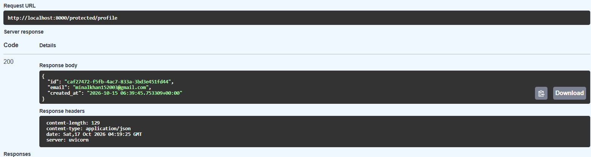

# FlyRank Auth API

A small authenticated REST API built with FastAPI and Supabase Auth. Users sign up, log in and log out through Supabase, and protected routes verify the Bearer token (JWT) on every request. The token check is a reusable dependency, so adding a new protected route is one line.

## Endpoints

| Method | Endpoint | Auth required | Description | Success | Errors |
|--------|----------|---------------|-------------|---------|--------|
| POST | `/auth/signup` | No | Create an account | 201 + user | 400 missing fields or signup failed |
| POST | `/auth/login` | No | Log in, returns access and refresh tokens | 200 | 400 missing fields, 401 invalid credentials |
| POST | `/auth/logout` | Yes | Sign out the current session | 204 | 401 missing or invalid token |
| GET | `/public/info` | No | Public message | 200 | none |
| GET | `/protected/profile` | Yes | Current user's id, email and created_at | 200 | 401 missing or invalid token |
| GET | `/protected/dashboard` | Yes | Welcome message for the logged-in user | 200 | 401 missing or invalid token |

Protected routes expect the header `Authorization: Bearer <access_token>`.

## Setup

1. Clone the repo and open the folder.
2. Create and activate a virtual environment:
```bash
   python -m venv venv
   venv\Scripts\activate        # Windows
   source venv/bin/activate     # Mac/Linux
```
3. Install dependencies:
```bash
   pip install -r requirements.txt
```
4. Create a free project at [supabase.com](https://supabase.com). In **Project Settings, API Keys**, copy the **Project URL** and the **Publishable key**.
5. Copy `.env.example` to `.env` and fill in your own values:
```
   SUPABASE_URL=your_project_url
   SUPABASE_KEY=your_publishable_key
```
6. For local testing, in Supabase go to **Authentication, Sign In / Providers, Email** and turn **Confirm email** off. Otherwise login fails until the email is confirmed.

## Run

```bash
uvicorn main:app --reload --port 8000
```

The server prints `Server running and connected to Supabase`. Interactive docs are at http://localhost:8000/docs.

## Try it

```bash
curl -X POST http://localhost:8000/auth/login -H "Content-Type: application/json" -d '{"email":"you@example.com","password":"your_password"}'

curl http://localhost:8000/protected/profile -H "Authorization: Bearer <access_token>"
```

## Swagger UI

Click **Authorize**, paste the access token, then use **Try it out** on any protected route.




## Security notes

- `.env` is listed in `.gitignore` and must never be committed.
- Passwords are handled by Supabase Auth, never by this server.
- Logout revokes the session through Supabase. Per Supabase's docs, an access token that was already issued can stay valid until it expires.

## Stack

Python, FastAPI, Supabase Auth, Uvicorn.

